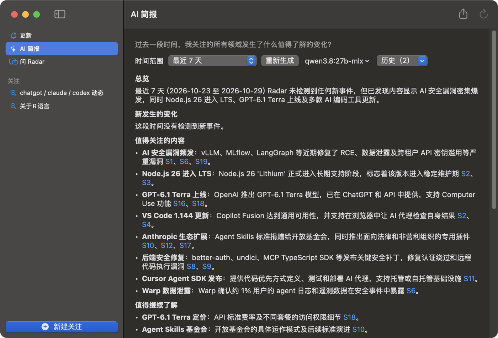
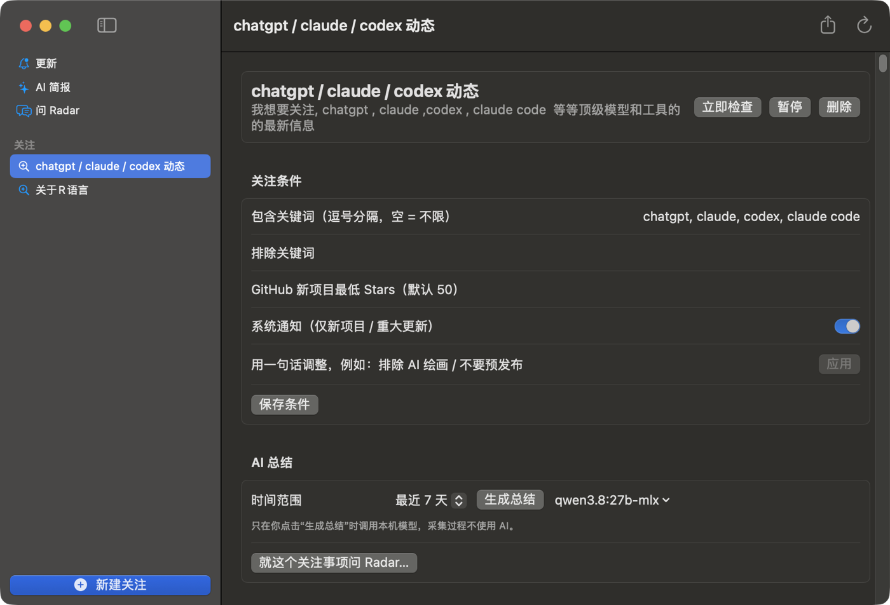
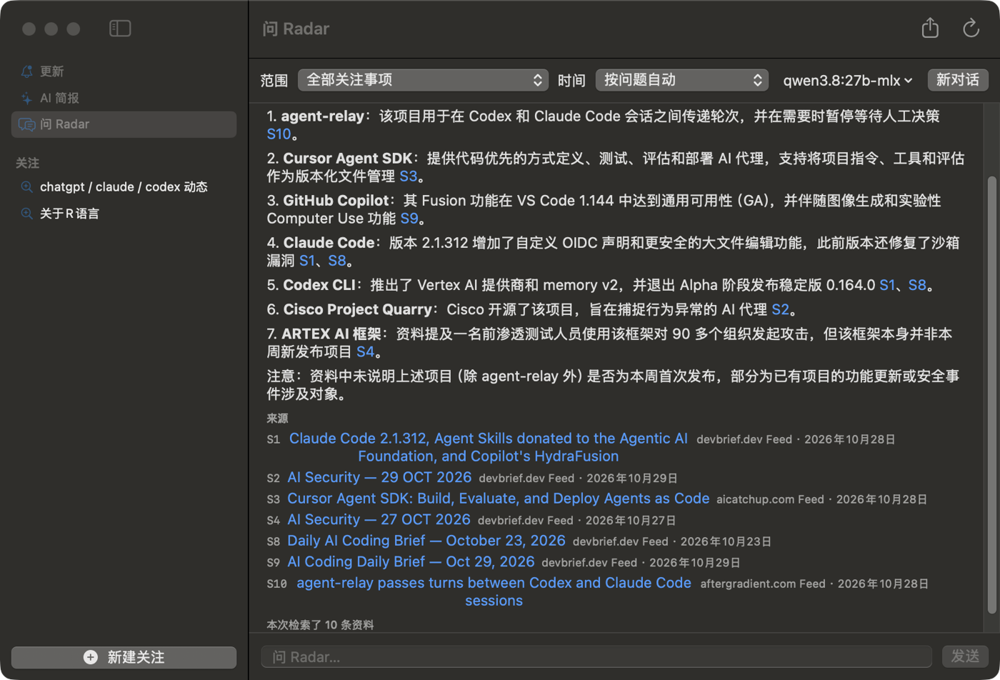

# Radar

**你的 Mac 上的个人信息雷达。** 用一句话说出你关心什么，Radar 帮你持续盯着，只在真正有新东西时告诉你，并且每一条都带原始链接。需要时，可以让你本机的 Ollama 帮你总结、回答问题。

- 原生 macOS App（SwiftUI），数据全部存在本机 SQLite。
- 日常采集不需要任何 API Key，也不调用任何 AI；AI 只在你点击时运行，并且只用本机 Ollama。
- 当前版本：**V0.2**（macOS 15+）。

## 界面







> 截图来自真实运行（本机 Ollama，模型 qwen3.8:27b-mlx，关注“chatgpt / claude / codex 动态”）。问答截图里模型把一些新闻条目也当成了“项目”，这是已知限制，见文末。

## 它能做什么

**1. 用一句话建立关注**
输入“关注 chatgpt、claude、codex 的最新动态”这样的话，Radar 解析出关键词和类型，自动寻找并试读信息源，确认能读到内容才加入。之后可以继续用一句话调整，例如“排除 AI 绘画”“不要预发布”“最低 100 stars”。

**2. 定期采集，只报新变化**

| 信息源 | 说明 |
| --- | --- |
| GitHub Releases | 新版本；可只看稳定版、设最低版本 |
| GitHub 仓库发现 | 按主题找新项目，并跟踪已发现项目的升温 |
| RSS / Atom | 自动从站点地址发现 Feed |
| 文章 / 项目列表页 | 没有 RSS 的站点，识别列表结构逐条去重 |
| 静态网页 | 内容变化时给出前后片段 |

- 新关注首次读取只建立基线，**不会把历史内容当成新事件**。
- 同一件事被多个来源报道会合并成一条事件，保留全部出处。
- 同一来源同时只会被抓取一次；支持 ETag/304、限流退避，错误会显示在来源上。
- 关闭窗口后继续在菜单栏运行，睡眠唤醒后自动补查。

**3. 事件与通知**
事件分为新项目、重大更新、页面变化等。主题类关注只对“新项目 / 重大更新”弹系统通知，其余留在 App 内的“更新”列表，避免打扰。

**4. AI 总结（本机 Ollama，手动触发）**
- 侧栏“AI 简报”总结全部关注，关注详情页里的“AI 总结”只总结这一个；范围可选 24 小时 / 7 天 / 30 天 / 全部。
- **“真实新变化”和“已发现内容”分开处理**：没有新事件时明确写“没有检测到新事件”，不会把首次采集的基线说成新增。
- 结论带 `[S编号]`，点击直达原文；链接来自数据库，不由模型生成。
- 结果保存在本地，每个“关注 + 范围”保留最近 20 次，可在“历史”菜单里回看；数据有更新时提示“可重新生成”。

**5. 问 Radar（本机 Ollama，手动触发）**
对你已采集的内容提问：“最近一周有哪些值得关注的 Agent 项目？”“比较前两个”。回答基于本地检索到的资料，带来源编号，流式输出，可随时停止、可继续追问（编号保持稳定）；资料不足时会直接说明，不会编造链接。可限定在某一个关注事项内提问。

**6. 导出信息源**
工具栏（或关注详情页“信息源”区块）一键导出全部信息源为 JSON：名称、类型、地址、抓取间隔、最近成功时间、被哪些关注使用。

## 快速开始

### 安装

需要 macOS 15 或更新版本、Xcode 命令行工具（Swift 6）。

```bash
git clone https://github.com/liamamilin/radar-lean.git
cd radar-lean
scripts/build_app.sh        # 生成 dist/Radar.app
open dist/Radar.app
```

构建产物默认是 ad-hoc 签名；第一次读取钥匙串（如保存了 GitHub Token）时系统会询问，选“始终允许”即可。
ad-hoc 签名每次重新构建都会变，钥匙串会再问一次；想避免的话，用你自己钥匙串里的代码签名证书构建（先 `security find-identity -v -p codesigning` 查看证书名）：

```bash
RADAR_SIGN_IDENTITY="你的证书名" scripts/build_app.sh
```

### 第一次使用

1. 点“新建关注”，输入一句话，例如：`关注 chatgpt、claude、codex 的最新动态`，点分析，确认来源后开始关注。
2. 首次读取只建立基线；之后出现的新内容才会进入“更新”。
3. 系统设置 → 通知 里允许 Radar，才能收到新项目 / 重大更新的通知。

### 启用 AI 功能（可选）

1. 安装并启动 [Ollama](https://ollama.com)，并 `ollama pull` 一个你喜欢的模型。
2. 打开 Radar 设置 → “本机 Ollama”，确认显示“已连接”，选择模型。
3. 在“AI 简报”或“问 Radar”里点击生成 / 提问。

Radar 不会自动下载模型，也不需要联网或 Key。Ollama 未运行时，其余所有功能照常使用。

### 可选设置

- **GitHub Token**：提高 GitHub API 限额，不需要任何权限范围，保存在系统钥匙串。
- **Exa API Key**：让主题类关注先联网搜索信息源再探测 RSS；不填则使用内置目录和 GitHub 搜索。

## 隐私与数据

- 所有数据在 `~/Library/Application Support/Radar/radar.sqlite`，不上传任何地方。
- AI 请求只发往本机 `127.0.0.1:11434`。云端模型（`*-cloud`）不会出现在模型列表里。
- 采集只访问你关注的来源；Token / Key 存在系统钥匙串。

## 工作方式（给想了解原理的人）

```
一句话 → 计划(规则解析) → 发现并试读来源 → 定期采集 → 基线 / 去重 → 事件(带原文链接) → 通知
                                                      └→ SQLite ←── AI 总结 / 问 Radar（仅用户触发，本机 Ollama）
```

- `Sources/RadarCore`：数据模型、采集、事件引擎、计划解析、来源发现、Ollama 客户端、检索与提示词。
- `Sources/Radar`：SwiftUI 界面、菜单栏、设置。
- 技术栈：SwiftUI · GRDB(SQLite) · FeedKit · SwiftSoup。
- 高频工作（采集、去重、分级、通知）由确定性规则完成，成本低；认知类工作（总结、问答）才交给本机模型，且必须由用户发起。

## 开发与测试

```bash
swift build                              # 调试构建
swift test                               # 49 个测试（fixture、本地 HTTP 服务器、假 Ollama），联网类默认跳过
RADAR_LIVE=1 swift test --filter LiveTests   # 真实联网测试（可选）
```

开发用环境变量：`RADAR_DB=<路径>` 使用临时数据库（并且不读取真实钥匙串）；`OLLAMA_HOST_URL` 覆盖 Ollama 地址，用来测试“未连接”状态。

逐轮的验证过程和已知限制见 [docs/DEVELOPMENT-LOG.md](docs/DEVELOPMENT-LOG.md)。

## 已知限制

- 不支持需要 JavaScript 渲染的页面；GitHub 发现只看近 90 天创建的项目。
- 相关性与质量判断是确定性规则，会有误判。
- AI 检索是关键词匹配，不懂同义词；新闻汇总类来源里的条目有时会被模型当成“项目”。8B 左右的本地模型偶尔会越界推断，请以原文为准。总结约 30–60 秒，问答约 10–30 秒。
- 系统通知横幅的弹出与点击跳转尚未验证；点击链接时若默认浏览器没有窗口，会自动改用 Safari 打开。
- 信息源只能导出，暂不支持导入。
- 暂停期间出现的内容在恢复后不补报。
